<h1 align="center">Shmily1368</h1>

  <a href="https://github.com/Shmily1368">GitHub</a> ·
  <a href="https://www.dailysecurity.cn/">DailySecurity</a> ·
  <a href="https://zhihu-circle.vercel.app/">Zhihu Circle</a>

<a href="./profile/stats-light.svg">
  <picture>
    <source media="(prefers-color-scheme: dark)" srcset="./profile/stats-dark.svg">
    <source media="(prefers-color-scheme: light)" srcset="./profile/stats-light.svg">
    
  </picture>
</a>

### 👋 Hi, I'm Shmily1368.

I explore **system security, privacy, and AI applications**, 
turning research ideas into practical tools.

- Security data pipelines and automated publishing
- Windows event collection and threat detection
- Explainable data analysis and visualization

 

<table width="100%">
<tr>
<td width="50%" valign="top">

**Featured Projects**

**[DailySecurity](https://github.com/Shmily1368/DailySecurity)**

Security papers, vulnerabilities, and threat intelligence in an automatically published daily digest.

[Visit site ↗](https://www.dailysecurity.cn/) · Python / Astro

**[Zhihu Circle](https://github.com/Shmily1368/zhihu-circle)**

Explore public follows and activity through explainable information circles and interactive graphs.

[Try the app ↗](https://zhihu-circle.vercel.app/) · Next.js / TypeScript

</td>
<td width="50%" valign="top">

**Recent Development**

<!-- recent-development:start -->
<a href="https://github.com/Shmily1368/DailySecurity/commit/982d0942142d7e45184c4f67a0f9324a6ddb8135">chore(data): publish verified daily security snapshot</a> 
DailySecurity · 2026-10-30 · 982d094

<a href="https://github.com/Shmily1368/DailySecurity/commit/e28b11868496b1ac22c9c58c57f29f677bea2613">fix(data): retain latest source files when model summaries are unavailable</a> 
DailySecurity · 2026-10-30 · e28b118

<a href="https://github.com/Shmily1368/DailySecurity/commit/513a47e3abfe7e683334ea6dae48b77b88819846">chore(data): publish verified daily security snapshot</a> 
DailySecurity · 2026-10-30 · 513a47e
<!-- recent-development:end -->

</td>
</tr>
</table>

**Working With**　C++ · Python · TypeScript · Java
